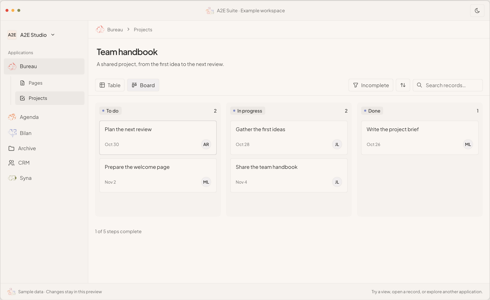
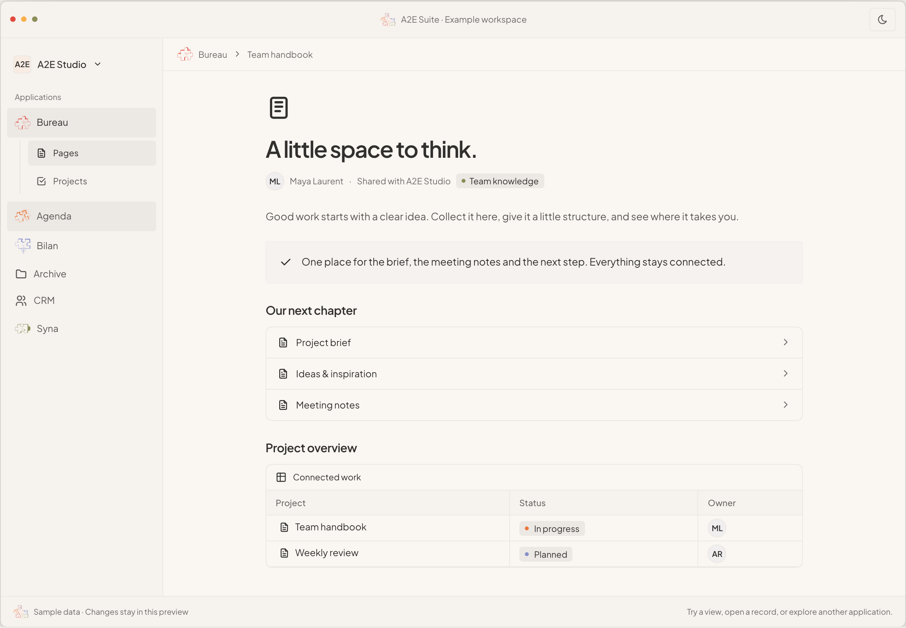
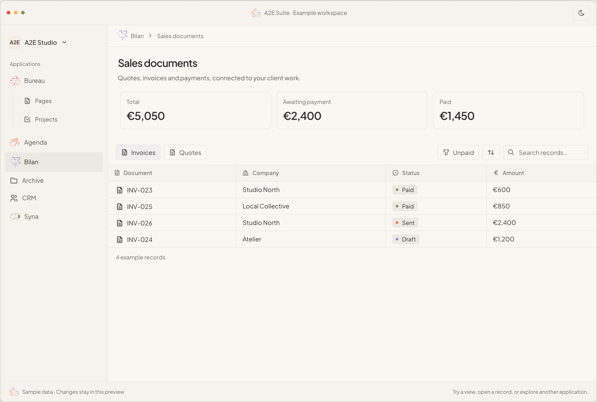
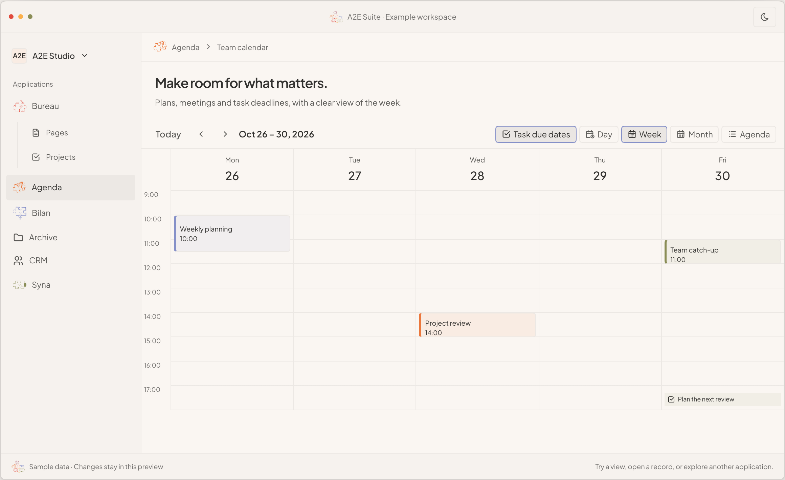

<p align="center">
  
</p>

<h1 align="center">A2E Suite</h1>

<p align="center">
  <strong>A little more space for your ideas.</strong><br />
  Notes, projects, calendars, files and finances. One modular workspace.
</p>

<p align="center">
  <a href="docs/README.md"></a>
  <a href="package.json"></a>
  <a href=".yarn/releases/yarn-4.13.0.cjs"></a>
  <a href="COPYRIGHT.md"></a>
</p>

<p align="center">
  <a href="https://a2esuite.com">Website</a> ·
  <a href="docs/README.md">Documentation</a> ·
  <a href="#local-development">Local development</a> ·
  <a href="DEPLOY.md">Deployment</a> ·
  <a href="COPYRIGHT.md">Rights &amp; attribution</a>
</p>

<p align="center">
  <picture>
    <source media="(prefers-color-scheme: dark)" srcset="docs/assets/readme/projects-dark.png" />
    
  </picture>
</p>

<p align="center"><sub>A2E product preview with sample data · Light and dark themes · Not a live customer workspace</sub></p>

## One workspace, only the apps you need

A2E Suite brings personal knowledge, shared work and organization management
into the same workspace. Write a page, plan a project, find a file or follow up
with a client without losing the context around your work.

Developed by **Association d’Entraide Étudiante**, the suite builds on Twenty’s
CRM and application platform, with A2E’s own identity and product experiences.
Existing CRM records, views, permissions and workflows remain part of the suite.

| Experience | What it brings together | Explore |
| --- | --- | --- |
| **Bureau** | Rich pages, nested knowledge, templates, projects, tasks and discussions | [Pages](packages/twenty-apps/internal/a2e-documents/README.md) · [Projects](packages/twenty-apps/internal/a2e-projects/README.md) · [Discussions](packages/twenty-apps/internal/a2e-chat/README.md) |
| **Agenda** | Calendar events, recurring plans, reminders and task deadlines | [Product guide](docs/product-experience.md) |
| **Bilan** | Quotes, invoices, expenses, income, budgets and connected cash books | [Finance experience](docs/bilan-experience.md) |
| **Archive** | Workspace files, folders, attachments and previews | [File management](packages/twenty-apps/internal/a2e-drive/README.md) |
| **CRM** | People, companies, opportunities and relationship history | [Feature guide](docs/features.md) |
| **Syna** | Contextual AI assistance for workspace and client work | [Product guide](docs/product-experience.md) |

> **In active development.** Availability depends on the deployed version,
> installed applications, workspace permissions and configured providers.
> Bureau combines several applications; it is not a separate app to install.
> Product previews illustrate the experience, rather than certify a release.
> See [features](docs/features.md) and [application installation](docs/applications.md)
> for implementation details and setup requirements.

## A closer look

<table>
  <tr>
    <td width="50%" valign="top">
      
      <p><strong>Bureau</strong><br />A home for notes, shared knowledge and the work around them.</p>
    </td>
    <td width="50%" valign="top">
      
      <p><strong>Bilan</strong><br />Financial documents and cash movements beside your projects.</p>
    </td>
  </tr>
</table>

<details>
  <summary>Explore the Agenda preview</summary>

  <p></p>

</details>

All screenshots show A2E’s interactive public-site preview using fictional
records. They do not demonstrate persisted records, live collaboration or
connected financial services. [Screenshot sources and capture notes](docs/assets/readme/README.md).

## Find your starting point

| You want to… | Start here |
| --- | --- |
| Understand the suite and its naming | [Product experience](docs/product-experience.md) |
| Find or install applications | [Applications and troubleshooting](docs/applications.md) |
| Bring in Notion pages | [Import compatibility and limits](docs/notion-import.md) |
| Deploy your own instance | [Deployment](DEPLOY.md) · [Production runbook](docs/production-coolify.md) |
| Locate code and understand the architecture | [Codebase map](docs/plan/01-codebase-map.md) |
| Build a native application | [App authoring guide](packages/twenty-apps/README-A2E.md) |
| Review delivery priorities | [Delivery plan](PLAN.md) |
| Work on the repository | [Repository rules](AGENTS.md) · [Execution workflow](PROMPT.md) · [Verification](docs/verification.md) |

## Local development

Use **Node.js 24.x, version 24.5.0 or newer**, and the repository’s pinned
**Yarn 4.13.0**. PostgreSQL and Redis are required to run the platform.
The [verification guide](docs/verification.md) covers tooling and service setup.

From the repository root:

```sh
node --version
node .yarn/releases/yarn-4.13.0.cjs install --immutable
npx nx build twenty-shared --skip-nx-cache
```

For a first local setup, inspect and run the development environment script
against your local development services. It configures PostgreSQL/Redis and
initializes the development database:

```sh
bash packages/twenty-utils/setup-dev-env.sh
yarn start
```

`yarn start` runs the frontend, API and background worker. Application packages
have their own build, publish and installation steps; a platform build does
not install them into a workspace. Follow the [applications runbook](docs/applications.md).
For hosting, follow [DEPLOY.md](DEPLOY.md).

## Built on a shared foundation

| Layer | Technology |
| --- | --- |
| Interface | React 19, TypeScript, Vite, Jotai, Linaria, Lingui |
| API and background jobs | NestJS, GraphQL Yoga, TypeORM, BullMQ |
| Data and storage | PostgreSQL, Redis, S3-compatible file storage |
| Workspace and app tooling | Nx, Yarn 4, the application SDK and CLI |
| Verification | Jest, Testing Library, Playwright |

Internal directories and package names intentionally remain `twenty-*` for
compatibility. New experiences extend the existing records, permissions,
navigation and storage primitives. The [codebase map](docs/plan/01-codebase-map.md)
explains these boundaries.

## Rights and attribution

**Public for visibility and ongoing development. Public availability does not
place this project in the public domain.**

A2E Suite’s original branding, logos, artwork, screenshot compositions and
editorial copy are reserved by their respective rights holders. No separate
permission to copy, redistribute or use those materials for another product
is granted here, except as required by applicable law or an existing license.
For permission requests, contact [Association d’Entraide Étudiante](mailto:contact@association2e.org).
See the [A2E rights notice](COPYRIGHT.md).

The source code retains its applicable licenses: predominantly **AGPLv3** with
the Twenty Application Exception, **MIT** for designated packages, and separate
commercial terms for Enterprise-marked files. Those licenses continue to govern
covered code and grant the rights they describe; this README does not replace
or restrict them. Read [LICENSE](LICENSE) and the relevant package/file notices.

A2E Suite is an independently developed fork of [Twenty](https://github.com/twentyhq/twenty).
Upstream attribution and the [Twenty trademark policy](.github/TRADEMARK.md)
remain intact; no upstream affiliation or endorsement is implied.
